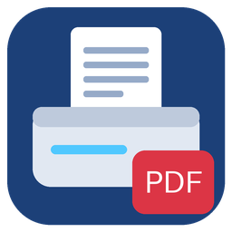

<p align="center">
  
</p>

<h1 align="center">brscan-skey</h1>

<p align="center">
  <b>Brother "Scan to PC" button → multi-page PDF in a folder.</b><br/>
  Made for Paperless-ngx, works with any folder. For models without Scan to FTP / Network.
</p>

<p align="center">
  <a href="https://hub.docker.com/r/devzwf/brscan-skey" target="_blank"></a>
  <a href="https://hub.docker.com/r/devzwf/brscan-skey" target="_blank"></a>
  <a href="https://hub.docker.com/r/devzwf/brscan-skey/tags" target="_blank"></a>
  
  <a href="LICENSE"></a>
  <a href="CHANGELOG.md"></a>
  <a href="https://ko-fi.com/devzwf" target="_blank"></a>
</p>

<p align="center">
  <a href="#quick-start">Quick start</a> ·
  <a href="#requirements">Requirements</a> ·
  <a href="#settings">Settings</a> ·
  <a href="#troubleshooting">Troubleshooting</a> ·
  <a href="https://github.com/devzwf/brscan-skey-docker/issues">Issues</a>
</p>

---

Press **SCAN → Scan to PC** on a Brother network scanner and get a **multi-page PDF** in a folder: the Paperless-ngx `consume` folder, a Nextcloud folder, an SMB share, and so on.

This is useful on models that have no "Scan to FTP / Network / SharePoint" menu (many North American models, such as the DCP-L2550DW). The container runs Brother's `brscan-skey` daemon. It registers with the device, waits for the button, scans with SANE and writes the PDF.

- Takes every page in the document feeder. When the feeder is empty, it scans the glass.
- Writes compact PDFs: JPEG for gray and colour, CCITT G4 for black & white. The page size is preserved.
- Writes each file atomically, so a watcher such as Paperless never picks up a half-written file. The owner is configurable (`PUID`/`PGID`, default `99:100` for Unraid).
- Runs on `linux/amd64` only, because Brother publishes x86 drivers only.


## Requirements

1. **Host networking.** The device sends the button event to UDP port 54925 on the host.
2. **The device must accept SNMP writes.** `brscan-skey` registers itself with an SNMP SET. On the device's web page, go to **Network → Network → Protocol → SNMP** and choose **"SNMP v1/v2c read-write access"**. If you set a custom *Set* community, put the same value in `SNMP_COMMUNITY`. Without this, the device shows **"No PC found"**.
   Choosing this mode disables SNMPv3. Read-only tools, such as the Home Assistant Brother integration (v2c `public`), keep working.
3. **A model supported by brscan4.** Most Brother laser and inkjet models from about 2012 to 2020 are supported. Run `docker run --rm --entrypoint list-models devzwf/brscan-skey` for the list. The container refuses to start with an unknown model.

## Quick start

```bash
docker run -d --name brscan-skey --network host --restart unless-stopped \
  -e SCANNER_IP=192.168.1.50 \
  -e SCANNER_MODEL=DCP-L2550DW \
  -e SKEY_USER=Paperless \
  -e TZ=America/Toronto \
  -v /path/to/paperless/consume:/output \
  devzwf/brscan-skey:latest
```

```yaml
services:
  brscan-skey:
    image: devzwf/brscan-skey:latest
    container_name: brscan-skey
    network_mode: host
    restart: unless-stopped
    environment:
      SCANNER_IP: 192.168.1.50
      SCANNER_MODEL: DCP-L2550DW
      SKEY_USER: Paperless
      TZ: America/Toronto
      PUID: 1000
      PGID: 1000
    volumes:
      - ./consume:/output
```

Then, on the device, press **SCAN → Scan to PC → File**, choose your PC (the `SKEY_USER` name) if the device asks, and press **OK**.

## Settings

| Variable | Default | Description |
|---|---|---|
| `SCANNER_IP` | *(required)* | IP address of the device. Use a static lease. |
| `SCANNER_MODEL` | *(required)* | Model name as known to brscan4, e.g. `DCP-L2550DW`. |
| `SKEY_USER` | `brscan` | Name shown on the device screen. |
| `SNMP_COMMUNITY` | `internal` | SNMP *Set* community used to register. |
| `SCAN_RESOLUTION` | `300` | 100, 150, 200, 300, 400, 600 dpi. Use 300 for OCR. |
| `SCAN_MODE` | `True Gray` | `Black & White`, `Gray[Error Diffusion]`, `True Gray`, `24bit Color[Fast]` (depends on the model). |
| `SCAN_PAGE_SIZE` | `Letter` | `Letter`, `A4` or `Legal`. |
| `SCAN_WIDTH_MM` / `SCAN_HEIGHT_MM` | *(from page size)* | Custom scan area. The maximum width is usually 211.9 mm. |
| `JPEG_QUALITY` | `80` | JPEG quality inside the PDF. |
| `FILENAME_PREFIX` | `scan` | Files are named `<prefix>_YYYY-MM-DD_HHMMSS.pdf`. |
| `PUID` / `PGID` | `99` / `100` | Owner of the created files. |
| `TZ` | `Etc/UTC` | Time zone, used for file names and logs. |
| `SCANNER_NAME` | `Brother` | Internal SANE name. You can leave it as is. |

Every **Scan to PC** target (File, Image, OCR, E-mail) produces the same PDF.

## How it works

1. At startup, the container registers the device with the brscan4 SANE backend. It then starts `brscan-skey`, which tells the device "send scan button events for *SKEY_USER* to this host". The registration is refreshed every few minutes, so it comes back after the device reboots.
2. When the button is pressed, `scanimage --batch` reads the feeder. If no page comes out, it scans the flatbed.
3. The pages are assembled with `img2pdf`. The PDF is written to `/output/.brscan-tmp/`, then renamed into `/output`. Paperless only consumes the top level of its folder (when not recursive), so the hidden subfolder is ignored.

## Troubleshooting

- **"No PC found" on the device:** SNMP is read-only. See Requirements, step 2. Check that the container runs with `--network host`.
- **Nothing happens after OK:** look at `docker logs brscan-skey`. Each scan logs `start` and then `OK: N page(s) → file.pdf`.
- **"Document feeder jammed":** the pages read before the jam are kept in the PDF.
- **Wrong name on the device:** set `SKEY_USER`, then restart the container.
- **Several hosts registered:** the device lists every registered PC. Stop any other `brscan-skey` instance on your network.

## Building

```bash
docker build -t brscan-skey:local .
```

CI (Gitea Actions): `secrets.yml` runs gitleaks on the full history, `ci.yml` builds and smoke-tests every push. `release.yml` publishes `X.Y.Z`, `X.Y` and `latest` to Docker Hub when a `vX.Y.Z` tag is pushed (the tag must match `VERSION`). It also rebuilds the latest release every Monday to pick up Debian security updates.

## License

The files in this repository are under the [MIT](LICENSE) license. The Brother drivers keep their own license; see [THIRD_PARTY.md](THIRD_PARTY.md). This project is not affiliated with or endorsed by Brother Industries, Ltd. "Brother" is a trademark of its owner.
